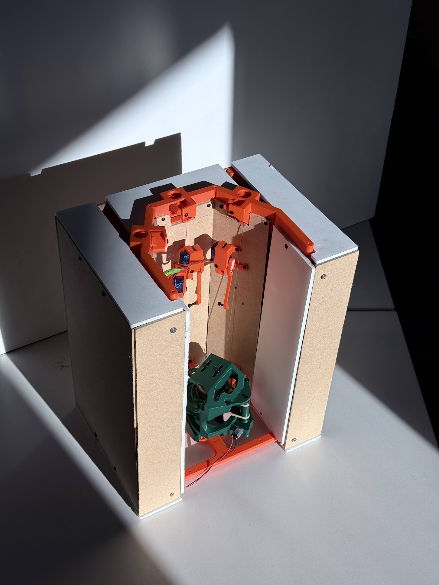
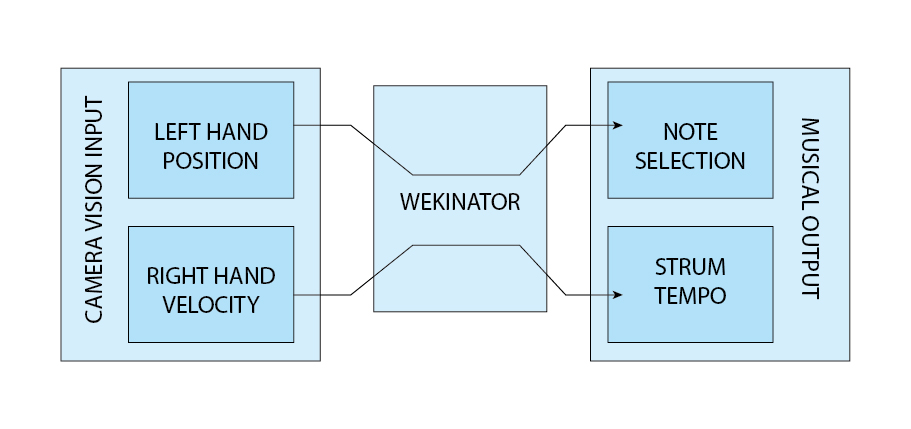
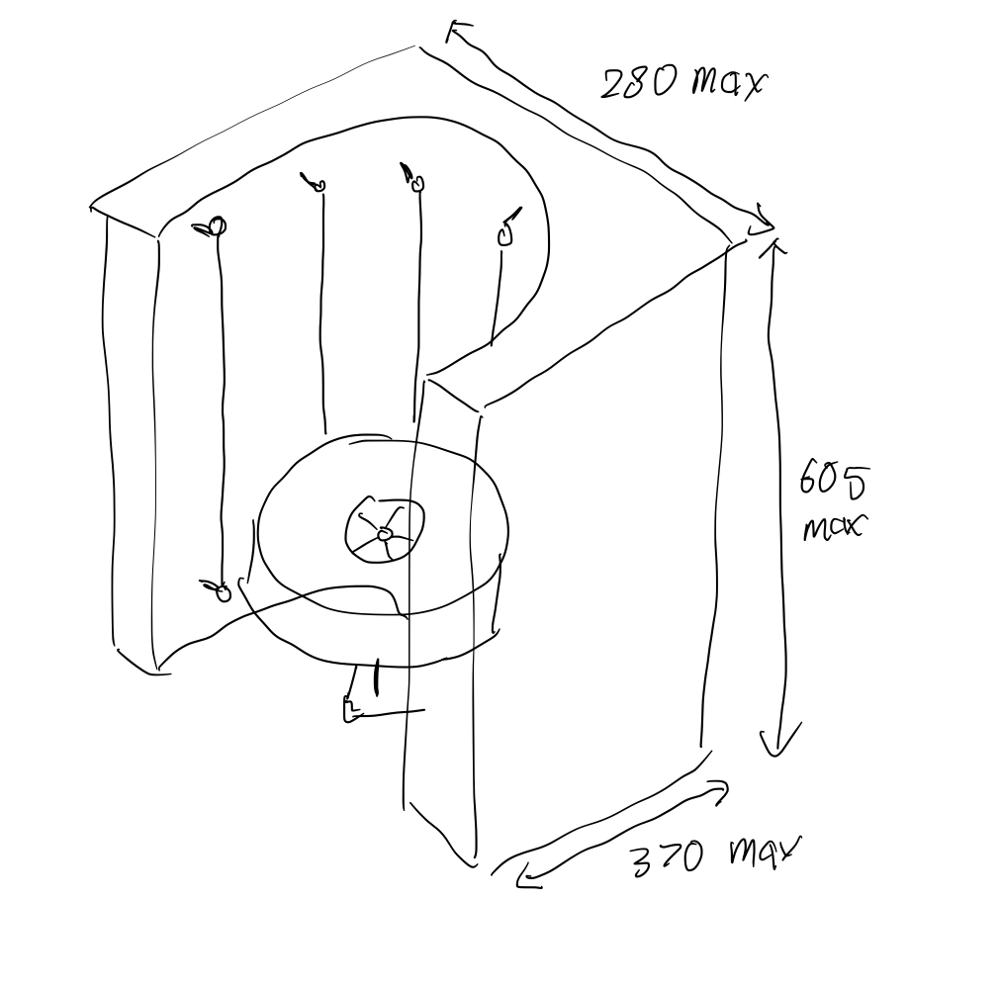
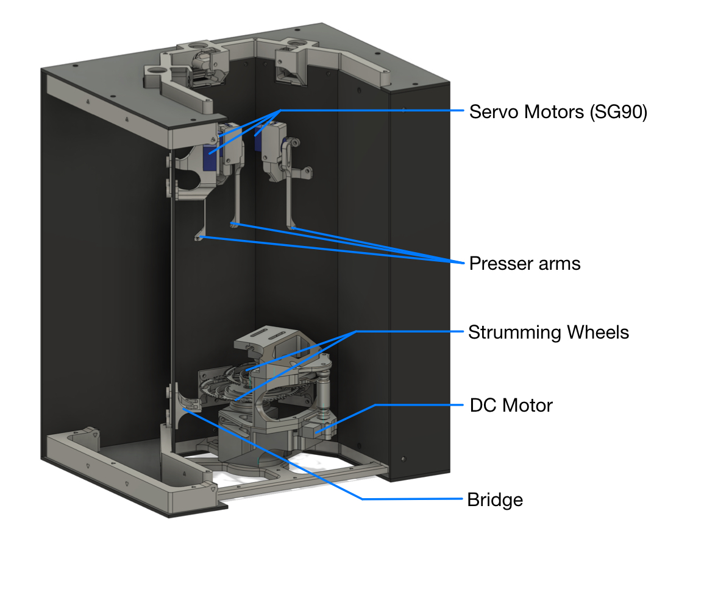
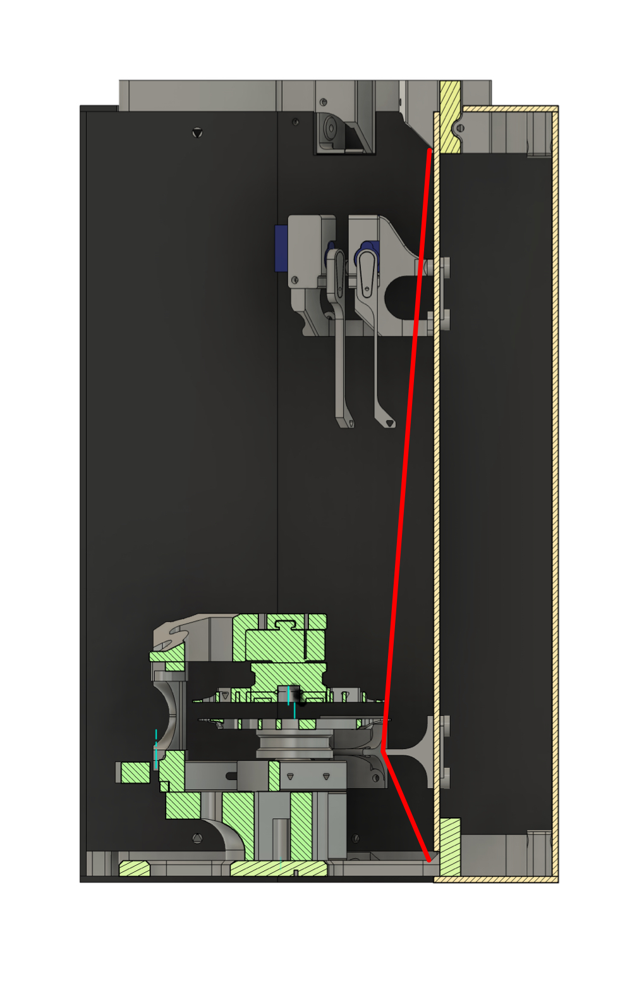
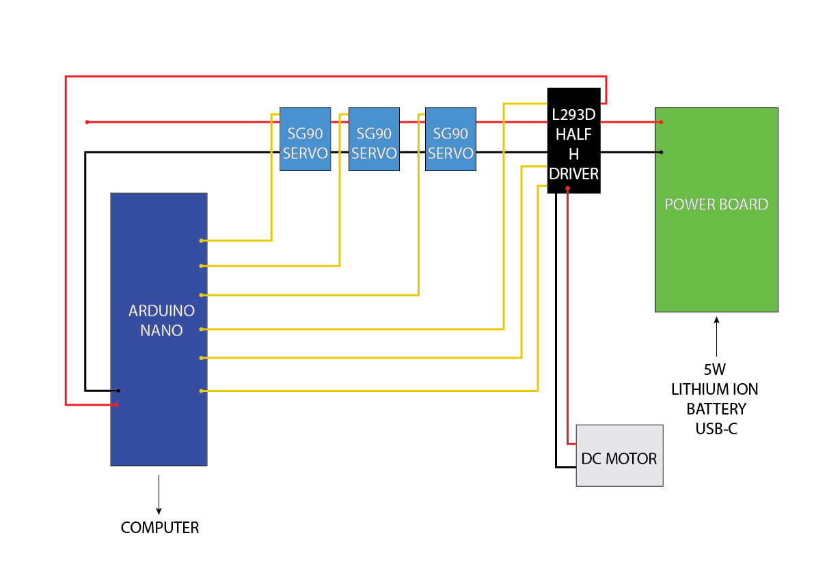
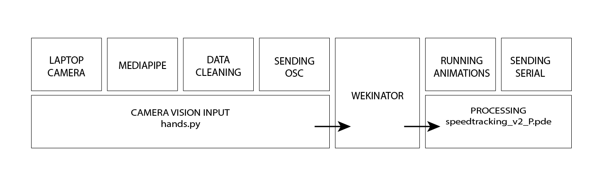
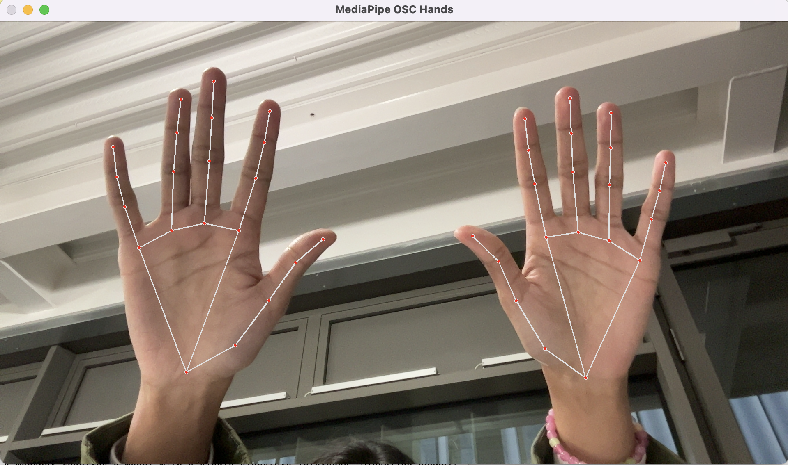
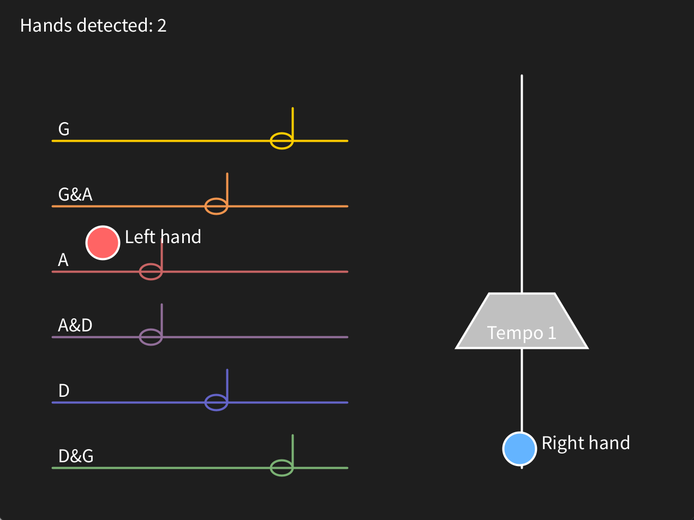
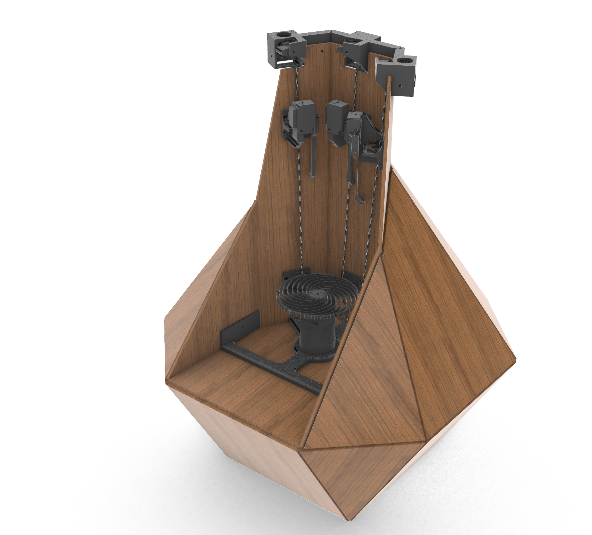

# Cyber Physical Systems 2026 - Group 4

## Overall concept

This project is a camera controlled strings-based music box. The user’s left hand height controls the instrument’s pitch and their right hand’s speed its tempo.

The instrument is inspired by the concept of an air guitar, being a gesture that anyone can emulate even if they cannot play a guitar.

A computer vision system tracks the user’s hands, classifying their positions based on a pre-trained machine learning (ML) model. This information is then sent to the Arduino in the instrument to perform the corresponding action. For further details, refer to the dedicated section in software design.

The Arduino controlling the instrument controls three servo motors and one DC motor. Each string has its own servo motor, allowing each string to produce two notes. The DC motor is responsible for strumming all three strings. For further details, refer to the dedicated section in software design.

## Mechanical Design

This section details the development of the mechanical design for this project.

The instrument relies on the basic principle of an acoustic string instrument. In which a vibrating string is coupled to a soundboard via a bridge. The string's vibrations are transmitted through the bridge and to the soundboard, producing sound that is amplified by the resonance chamber.

The design was guided by form, with suitable materials sourced from IDE’s Makerspace in Battersea to construct the resonance chamber’s walls. Off-cuts of MDF board were mounted to an FDM 3D printed frame.

The 3D printed frame provides mounts for the wheels which strum the strings. Tuners to tension the strings are designed into the 3D printed frame.

Each servo controls an arm that presses into its respective string. The thinness of each arm is intentional, allowing it to flex as it presses into the string. This allows a more constant pressure to be applied.

Two wheels strum the three strings. The lower one is responsible for the left and middle, while the upper is dedicated to the right string. Originally intended as a single wheel similar to a Hurdy Gurdy, the current design was adopted in favour of easier fine-tuning of the wheel to string contact distance. Both wheels are driven by a DC motor connected to a pulley system that uses a rubber-band as a belt.

## Hardware Design

Below is a list of the electronics used in this project, their respective manuals are in the electronics directory.

| No. | Item | Count | Description |
|---|---|---|---|
| 1 | Servo Motor | 3 | SG90 used for this project, For pressing the strings to change tones. |
| 2 | DC Motor with Reduction Gearbox | 1 | Anreak GW1812 N20 used, can be substituted for any other high-torque DC motor given adjustments to the mounting. |
| 3 | Arduino Nano Every | 1 | The "Brain" of the instrument. Provided for the module, can be substituted with a similar microcontroller given adjustments to the code for pin connections. |
| 4 | USB DC Power Supply | 1 | DC Power supply that provides power to the motors. Provided as part of the course materials and can be substituted with a similar power supply. |
| 5 | L293D Half H Driver | 1 | H-Bridge for safely controlling the DC motor using the chosen microcontroller. |

## Software Design

This section details the communication between the programming and machine learning softwares used in this project. 

### Mediapipe OSC:
 This project uses Mediapipe OSC hand tracking script, hands.py, to track movement of two hands through a webcam and send the data, 1 hand-count value and 168 landmark values (84 per hand), to Processing via OSC on port 7500.

### Processing: 
Receives the raw data. Checks the hand count value. Draws a visual interface to display the hand tracking points and UI elements. 

It then extracts the X and Y co-ordinates for the two wrists from the received data and orders them as left or right hand. Then sends the values of the left hand to Wekinator for classification on port 6448. 

The values of the right hand are stored and used to calculate average speed of movement over 1 second. Processing uses threshold and hysteresis rules to classify the speed average into four speed classes; 0, 1, 2, 3. A half a second grace period is applied if both hands are not detected to allow for brief tracking gaps, before setting the speed class to 0.

### Wekinator: 
Receives the Left hand’s X and Y co-ordinates from Processing. Makes a prediction classifying the input into 7 classes, and sends to Processing as output 1 on port 12000.

### Processing, pt.2: 
Sends output 1, received from Wekinator, as well as output 2, the speed class, to Arduino as a comma-separated serial message using 9600 serial baud rate. As a troubleshooting check, receives and prints a message from arduino confirming the outputs were received correctly.

### Arduino: 
Reads the class values. Output 1 controls the movements of 3 servos and Output 2 controls a DC motor through a L293D motor driver. Also communicates with Processing (for troubleshooting).

## Setup Walkthrough:

**Servo connections:**
 - Connect servo 1 to pin 12 
 - Connect servo 2 to pin 11 
 - Connect servo to pin 10

**DC Motor connection:**
 - Connect DC motor positive lead to Hbridge pin 3
 - Connect DC motor negative lead to Hbridge pin 6

**H-bridge connections:**
 - Connect Hbridge pin 1 to arduino pin 8 
 - Connect Hbridge pin 2 to arduino pin 7 
 - Connect Hbridge pin 4 to Hbridge pin 5 
 - Connect Hbridge pin 5 to common ground 
 - Connect Hbridge pin 7 to arduino pin 6 
 - Connect Hbridge pin 8 to +5V Bus 
 - Connect Hbridge pin 16 to +5v pin on arduino
   board

**Power supply:**
 - Connect Power source +5V to positive bus
 - Connect Power source -5V to common ground bus
 - Connect arduino ground to common ground
 - Connect arduino to computer port

**Software startup:**
 - Open Arduino IDE, upload code to arduino
 - Open Mediapipe tracker OSC
 - Open processing sketch
 - Open Wekinator model

# Machine Learning Description
This section describes the use of machine learning software Wekinator in this project. 

## Wekinator 

Receives 2 inputs from Processing of left hand’s X and Y position.

### Training: 
With the Mediapipe OSC hand tracker and Processing running, show both the left and right hand on screen (Processing has been coded to only send inputs if two hands are present).

Move the left hand within the designated boxes for each class 1-6 (and a little over to the sides in case of user error). For class 0, move the left hand within the right half of the screen.

Classify inputs into 7 classes:

 - 0 = No strings pressed 
 - 1 = String G 
 - 2 = String G and A 
 - 3 = String A 
 - 4 = String A and D 
 - 5 = String D 
 - 6 = String D and G

Send class predictions to Processing

## Development & previous iterations

### Mediapipe OSC
This project uses Mediapipe OSC hand tracking script, hands.py.

### Machine Learning
Previous machine learning iterations included color tracking, left and right hand tracking, left hand tracking with right hand speed tracking in Wekinator. These were all tested and found to be either inaccurate, disturbed easily by environmental factors or the user experience was unsatisfactory. This led to our current iteration allowing the user to experiment and adapt the motions to their own preferred style, for example, mimicking a guitar or an orchestra conductor’s movements.

## Limitations and Potential Development

### Limitations:
Due to power constraints, the control board, and speed of motors used, the latency between user gestures and output sounds makes the instrument difficult to learn.
Due to the acoustic properties of the materials used in the prototype, the sound quality is poor.
 
### Future development:

Performance of the instrument could be improved through:

 - Increasing the speed of the motor would create a more musical tone.
 - Utilising a wheel made of a more suitable material with the addition of Rosin.
 - Utilising laser-cut plywood for the resonance chamber’s panels.
 - Metal tuners for tensioning the strings would enable greater durability and ease of tuning.
 - Individual wheels for each string would enable easier tuning of the contact distance.

### Disclaimer on AI usage: 
Some formatting and evaluation work in this readme and accompanying code was done using OpenAI Codex using the model gpt-5-codex and Anthropic Claude Sonnet 5 model respectively. All documentaion is handwritten. 

Cyber Physical Systems — Group 4 - Aysha Saleem, Ikeadi Ndukwu, Jonathan Yim 

